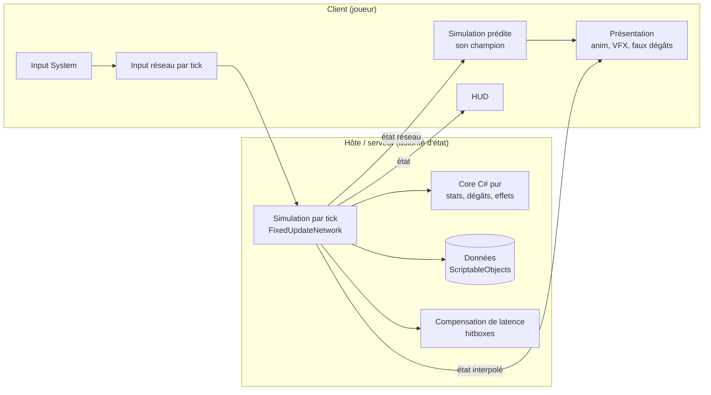
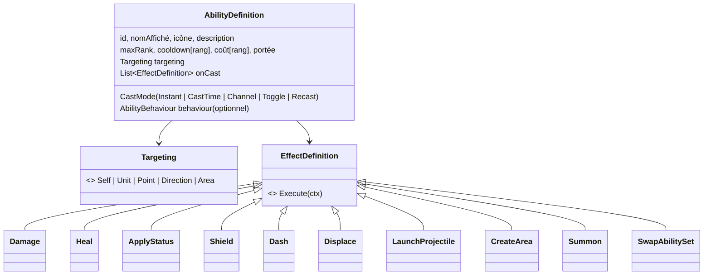
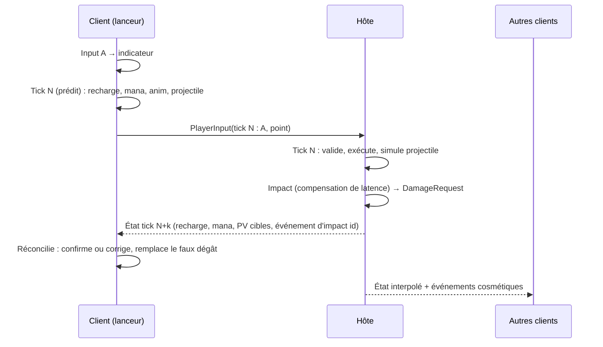

# MangaLegends — Architecture technique

> Statut : **cible v0.2** (2026-11-24). Décrit l'architecture visée par la réécriture. L'ancien code est décrit dans [06-plan-refactor.md §1](06-plan-refactor.md#1-audit-du-code-existant).
> Toute modification structurelle met ce doc à jour et, si c'est une décision, ajoute un ADR dans [adr/](adr/).

## 1. Principes

1. **Serveur autoritaire, client prédictif.** Le serveur calcule et valide tout ce qui compte : dégâts, soins, recharges, mana, or, objets, morts. Le client **prédit** ses propres actions (déplacement, lancement, projectiles) et affiche des **retours provisoires** (« faux » dégâts, impacts) pour que le jeu paraisse instantané ; le serveur confirme ou corrige. ([ADR-0002](adr/0002-serveur-autoritaire.md))
2. **Simulation séparée de la présentation.** La simulation ne connaît ni l'UI, ni les animations, ni les VFX. Elle expose un état et des événements ; la présentation s'y abonne et peut prendre de l'avance (prédiction visuelle).
3. **Tout est configurable.** Champions, compétences, effets, objets, monstres, règles de partie et valeurs d'équilibrage sont des **données** (ScriptableObjects). Rien de gameplay n'est en dur. ([ADR-0003](adr/0003-competences-pilotees-par-les-donnees.md))
4. **Composition plutôt qu'héritage.** Une unité est un assemblage de composants (`Health`, `UnitStats`, `AbilityCaster`…).
5. **Dépendances explicites.** Pas de `GameObject.Find`, pas de singletons statiques mutables. Références sérialisées ou injectées par une composition root.
6. **Testable.** Les règles (stats, dégâts, recharges, effets) sont en C# pur dans `Core`, couvertes par des tests EditMode, indépendantes de la bibliothèque réseau.

## 2. Pile technique

| Sujet | Choix |
|---|---|
| Moteur | **Unity 6 LTS** ([ADR-0005](adr/0005-unity-6-lts.md)) |
| Réseau | **Photon Fusion 2**, mode **Host** (un ami héberge, relais Photon, pas de ports à ouvrir), mode **Server** dédié possible plus tard ([ADR-0006](adr/0006-photon-fusion-2.md)) |
| Entrées | Input System |
| Navigation | NavMesh (AI Navigation) pour le calcul de chemins ; déplacement simulé par notre code |
| UI | UGUI (UI Toolkit possible pour les menus) |
| Données | ScriptableObjects, Addressables quand le contenu grossit |
| Tests | Unity Test Framework (EditMode + PlayMode) |

Public visé : **jeu entre amis**, pas de diffusion publique. Le quota gratuit de Photon (100 joueurs simultanés) suffit.

## 3. Vue d'ensemble



### 3.1 Modèle de simulation (Fusion)

- La simulation avance par **ticks fixes** (`TickRate` 30 Hz au départ, configurable) dans `FixedUpdateNetwork()`.
- Le client n'envoie **pas de commandes libres** : il envoie chaque tick une **structure d'entrée** (`PlayerInput : INetworkInput`) : destination de clic, cible, boutons de compétence, point/direction visés, achat demandé.
- **Hôte** : exécute la simulation faisant foi (`HasStateAuthority`).
- **Client** : exécute la même simulation **pour son propre champion** en avance (prédiction), puis rejoue (resimulation) quand l'état serveur arrive. Les autres unités sont **interpolées** (`Render()`).
- Tout état qui doit être prédit ou répliqué est une propriété `[Networked]` ; aucune logique d'état ne dépend de `Update()` ni de coroutines.

### 3.2 Ce qui est prédit, ce qui ne l'est pas

| Élément | Client local | Serveur |
|---|---|---|
| Déplacement de son champion | prédit, corrigé | autorité |
| Début de lancement (anim, indicateur, recharge, mana) | prédit | valide (silence ? recharge ? mana ? portée ?) |
| Projectiles de son champion | prédits (simulés localement) | simulés + collisions avec **compensation de latence** |
| Impact, nombre de dégâts | **provisoire** : VFX + nombre « prédit » | calcule le vrai résultat ; le client remplace le provisoire, ou l'annule si l'impact n'a pas eu lieu |
| PV, boucliers, morts, or, objets, XP | jamais prédits (affichage provisoire seulement) | autorité |
| Autres unités (champions, sbires, monstres, tours) | interpolées | autorité |
| Aléatoire (critiques) | jamais tiré côté client | `NetworkRNG` / graine par tick |

## 4. Assemblies et dossiers

Le code vit dans `Assets/_Project/`. Chaque dossier = une assembly (`.asmdef`) : les dépendances interdites ne compilent pas.

| Assembly | Contenu | Dépend de |
|---|---|---|
| `MangaLegends.Core` | C# pur : `StatBlock`, `StatModifier`, `DamageCalculator`, `Cooldown`, logique des statuts, types | rien |
| `MangaLegends.Data` | ScriptableObjects : `ChampionDefinition`, `AbilityDefinition`, `EffectDefinition`, `ItemDefinition`, `UnitDefinition`, `GameRulesConfig`, `ContentRegistry` | Core |
| `MangaLegends.Simulation` | Composants réseau d'unités, compétences, projectiles, IA, économie, flux de partie (tout ce qui tourne dans `FixedUpdateNetwork`) | Core, Data, Fusion |
| `MangaLegends.Networking` | Démarrage du `NetworkRunner`, sessions, lobby, spawn des joueurs, collecte d'input | Simulation, Fusion |
| `MangaLegends.Input` | Actions Input System → `PlayerInput` | Simulation |
| `MangaLegends.Presentation` | Animation, VFX, audio, faux dégâts, indicateurs de visée, barres de vie | Simulation (lecture seule), Data |
| `MangaLegends.UI` | HUD, boutique, scores, menus | Simulation (lecture seule), Data |
| `MangaLegends.Editor` | Outils, validateurs de données | tout |
| `MangaLegends.Tests.EditMode` / `.PlayMode` | Tests | selon besoin |

Règle : **Core et Data ne référencent jamais Fusion, l'UI ni la présentation.** Si on change de bibliothèque réseau, seules `Simulation` et `Networking` bougent.

```
Assets/
  _Project/
    Core/ Data/ Simulation/ Networking/ Input/ Presentation/ UI/ Editor/
    Content/      (assets de données : Champions/, Abilities/, Items/, Units/, Rules/)
    Tests/EditMode/   (asmdef MangaLegends.Tests.EditMode)
    Art/ Audio/ Prefabs/ Scenes/ Settings/
  Photon/         (Fusion, géré par le SDK)
  Plugins/        (tiers)
Docs/
Tools/CoreTests/  (projets .NET pour compiler et tester le Core sans Unity)
Legacy/           (ancien code, non compilé, supprimé à l'étape 10)
```

## 5. Modèle d'unité

Toute entité combattante (champion, sbire, tour, monstre, invocation) est un prefab `NetworkObject` composé de :

| Composant | Responsabilité | État réseau |
|---|---|---|
| `Unit` | Identité : définition, équipe, type ; accès aux autres composants | `[Networked]` équipe, id de définition |
| `UnitStats` | `StatBlock` (Core), niveau, modificateurs actifs | niveau + liste compacte des modificateurs (source, type, valeur) |
| `Health` | PV, boucliers, mort, réapparition ; **seul point d'entrée des dégâts** | PV, boucliers |
| `ResourcePool` | Mana ou ressource alternative, régénération par tick | valeur |
| `StatusEffects` | Contrôles, buffs/debuffs, marques, cumuls, immunités | `NetworkArray` d'effets actifs (id, tick de fin, cumuls, source) |
| `UnitMotor` | Déplacement : chemin NavMesh calculé localement, avance de `vitesse × dt` par tick ; dashs, projections, téléports | position, destination, état de déplacement forcé |
| `AutoAttack` | Cible, portée, cadence, projectile d'AA | cible, tick de prochaine attaque |
| `AbilityCaster` | Emplacements P/A/Z/E/R, `AbilitySet` actif, rangs, recharges, charges, canalisation | tick de fin de recharge par emplacement, charges, set actif |
| `Vision` | Rayon de vision, révélation | — |
| `HitboxRoot` + `Hitbox` | Volumes pour la compensation de latence | géré par Fusion |
| Champion : `Experience`, `Wallet`, `Inventory`, `Scoreboard` | | `[Networked]` |
| IA : `MinionBrain`, `TowerBrain`, `MonsterBrain` | décisions, serveur uniquement | — |

Les temps (recharges, durées) sont stockés en **ticks** (`TickTimer`), jamais en `Time.time`.

## 6. Statistiques

- `StatType` : `MaxHealth, HealthRegen, MaxMana, ManaRegen, AttackDamage, AbilityPower, Armor, MagicResist, AttackSpeed, MoveSpeed, AttackRange, CritChance, CritDamage, Lethality, ArmorPen, MagicPen, LifeSteal, HealPower, AbilityHaste`.
- `StatModifier { StatType, ModifierKind (Flat | PercentAdd | PercentMult), float value, SourceId }` ; retrait **par source**.
- Valeur : `(base + croissance × (niveau − 1) + Σflat) × (1 + ΣpercentAdd) × Π(1 + percentMult)`, mise en cache.
- Unités : pourcentages en fraction (`CritChance 0.25`, `ArmorPenetration 0.3`, `PercentAdd 0.1` = +10 %), `CritDamage` en multiplicateur (`2` par défaut, 07 §11), `AttackSpeed` en attaques par seconde.
- Implémentation : `MangaLegends.Core.Stats` (`StatBlock` implémente `IStatReader`, la base vient d'un `IStatBaseline` fourni par les données).
- Les formules (résistances, cadence d'attaque, plafonds) sont des paramètres de `GameRulesConfig`.

## 7. Combat

### 7.1 Pipeline de dégâts (autorité uniquement)

```
DamageRequest { source, target, amount, DamageType (Physical|Magical|True), flags (IsAbility, IsCrit…), abilityId }
  → modificateurs de l'attaquant (pénétration, bonus conditionnels)
  → résistance effective = résistance × (1 − péné. %) − péné. fixe (létalité), jamais < 0 si elle était positive
  → multiplicateur = S / (S + résistance), ou 2 − S / (S − résistance) si négative ; S = CombatRules.ResistanceScale (True : ignorée)
  → modificateurs du défenseur (réductions, absorptions)
  → boucliers (typés puis généraux)
  → Health.ApplyDamage → événements DamageApplied / Died (avec tick et id d'impact)
  → effets à l'impact (objets, passifs), vol de vie
```

### 7.2 Faux dégâts (retour provisoire côté client)

1. Le client prédit l'impact de son projectile / AA / compétence.
2. Il affiche immédiatement VFX, son et un **nombre provisoire** calculé avec `DamageCalculator` sur l'état qu'il connaît (style visuel distinct ou identique, au choix design).
3. Chaque impact porte un **id** (tick + emplacement + index). Quand l'événement serveur arrive avec le même id, le provisoire est remplacé par la vraie valeur ; s'il n'arrive pas dans un délai configurable, le provisoire est retiré.
4. La barre de vie peut montrer un segment « dégâts en attente » qui se confirme ou se restaure.

### 7.3 Effets de statut

`StatusEffectDefinition` : type (`Slow, Stun, Root, Silence, Knockup, Knockback, Taunt, Invisible, Untargetable, TimeStopped, Bleed, Burn, Mark…`), durée, valeur, cumul (`Refresh | Stack | Independent`), max de cumuls, tags. Requêtes : `CanMove`, `CanCast`, `CanAttack`, `IsTargetable`.
Marques (Gon, Kirito, Sasuke), cumuls (Zoro, Tanjiro) et boucliers (filtre de type, option « bloque les contrôles ») sont des statuts.

## 8. Compétences



- **Valeurs** : `ScalingValue { base[rang], ratios[] }`, chaque ratio = `{ source, stat, ratio[rang] }`. Valeur = base du rang + Σ ratio du rang × valeur de la source. Sources : stat totale, bonus ou de base du lanceur (AD, AP, PV, armure… : toute `StatType`), PV max / manquants / actuels de la cible, cumuls. Exemple : `60/100/140 (+50/60/70 % AP)`.
- **Projectiles et zones** décrits en données (`ProjectileDefinition` : vitesse, portée, rayon, perce ou non, effets à l'impact ; `AreaDefinition` : forme, durée, intervalle, effets par intervalle).
- **Ciblage client** = indicateur et contenu de l'input ; l'autorité revalide.
- **Comportements spéciaux** (Pain, Rimuru, Jotaro) : petite classe `AbilityBehaviour` branchée sur la définition, qui réutilise les effets génériques et dont les paramètres restent en données.
- **Formes** : `AbilitySet` interchangeable (stand, pantins, Igris, monstre absorbé).
- **Projectiles réseau** : pas un `NetworkObject` par projectile. Chaque `AbilityCaster` tient un tampon circulaire `[Networked]` de projectiles (tick de départ, origine, direction, définition) ; la position se calcule à partir du tick. Prédit par le lanceur, vérifié par l'hôte avec compensation de latence.

### 8.1 Séquence d'un lancement



## 9. Réseau

- **Session** : `NetworkRunner` en `GameMode.Host` via le cloud Photon (code de salon partagé entre amis). Le code ne suppose jamais que l'hôte est un joueur : `GameMode.Server` doit rester possible.
- **Identifiants** : `NetworkId` / `PlayerRef`, jamais le nom d'un GameObject.
- **RPC** : réservés aux événements ponctuels non prédits (chat, ping, fin de partie). L'état passe par `[Networked]`.
- **Compensation de latence** : `HitboxRoot`/`Hitbox` sur les unités, requêtes `Runner.LagCompensation` pour les impacts.
- **Brouillard de guerre** : l'intérêt (Area of Interest de Fusion) limite ce qui est envoyé à chaque joueur selon la vision d'équipe.
- **Effets globaux** : arrêt du temps = statut `TimeStopped` sur toutes les unités sauf le lanceur ; vision totale = surcharge temporaire de l'intérêt pour une équipe.
- **Sécurité** : partie entre amis, l'hôte fait foi ; on ne vise pas l'anti-triche contre un hôte malveillant.

## 10. Flux de partie

Scènes : `Boot` → `MainMenu` (créer / rejoindre un salon) → `Lobby` → `ChampionSelect` → `Match` (+ carte additive) → `PostGame`.
`MatchController` (autorité) : `WaitingForPlayers → Loading → Playing → Ended`, horloge en ticks, vagues, réapparitions, victoire. Règles dans `GameRulesConfig`.

Structures (GDD §6.1) : chaque tour, inhibiteur et Cœur placé sur la carte référence la structure qui le protège ; tant qu'elle tient, l'autorité refuse les dégâts. L'inhibiteur détruit lance un `TickTimer` de réapparition (`InhibitorRespawnSeconds`) et, pendant ce temps, le générateur de vagues de la voie remplace `SiegeMinion` par `MegaMinion`. Les tours reçoivent `EarlyTowerModifiers` jusqu'à `EarlyTowerDefenseSeconds`. Vagues : première à `FirstWaveSeconds`, intervalle et fréquence du siège en paliers de temps (`TimedValue[]`, valeurs de [07 §5](07-regles-de-jeu.md#5-sbires)). Ces règles sont vérifiées par `GameRulesConfig.Validate` (appelée par `ContentRegistry.Validate`).

## 11. Données et contenu

- Chaque définition a un **`id` stable** (`champion.ainz`, `ability.ainz.mantle_of_chaos`) ; le réseau transporte un **index compact** fourni par `ContentRegistry`.
- `ContentRegistry` liste toutes les définitions et construit un `ContentIndex<T>` par type (tri par id ordinal → même index réseau sur tous les pairs) ; *MangaLegends → Content → Validate* vérifie ids, doublons, tableaux par rang, références et recettes circulaires.
- Effets : classes `[Serializable]` dérivées de `EffectDefinition`, stockées en `[SerializeReference]` dans les compétences, projectiles, zones, statuts et objets ; l'inspecteur propose le type via `TypeSelectorAttribute`. Les effets sont des **données** : leur exécution vivra dans `Simulation` (étape 7), par un exécuteur par type d'effet.
- Valeurs par rang : tableau de 1 valeur (constante) ou de `MaxRank` valeurs.
- Coût : `Cost` au lancement et `CostPerSecond` tant qu'une compétence `Toggle` ou `Channel` est active (prélevé par tick par l'autorité ; ressource à 0 → la compétence s'arrête 🟡).
- Sorts d'invocateur : `SummonerSpellDefinition` (index `ContentRegistry.SummonerSpells`) enveloppe une `AbilityDefinition` ; le nombre d'emplacements vient de `GameRulesConfig.SummonerSpellSlots`. Ils passent par le même pipeline de lancement que les compétences. `TargetingData.Fallback` gère la cible de repli (allié le plus bas en PV) et `TeleportEffect` la téléportation vers une unité alliée.
- Économie : `ItemPricing` (Core) calcule coût total, devis d'achat (composants possédés consommés, y compris imbriqués) et revente ; l'autorité l'utilise, le client seulement pour l'affichage.
- Noms et textes affichés dans les données (localisables plus tard).
- Équilibrage : modifier un asset suffit ; pas de recompilation.

## 12. UI et entrées

- HUD lié au champion local via un `LocalPlayerContext` fourni au démarrage ; vues sans règles, abonnées aux événements.
- Input System, un asset `MangaControls.inputactions` (cartes `Gameplay`, `UI`), remappage sauvegardé. `PlayerInputCollector` remplit `PlayerInput` dans le callback `OnInput` de Fusion. Aucun autre script ne lit les entrées.

## 13. Tests et outils

- EditMode : Core (stats, dégâts, cumuls, recharges), validation des données.
- PlayMode : partie locale en hôte, lancement de compétence, achat.
- Multi-instances : Multiplayer Play Mode d'Unity 6 pour tester plusieurs clients dans l'éditeur.
- Simulation de latence (réglages Fusion) pour valider la prédiction.
- Triches en build de développement uniquement, passées par l'input et exécutées par l'autorité.

## 14. Points à prototyper en premier

1. **Déplacement prédit sur NavMesh** (clic-pour-bouger + resimulation) : vérifier coût et stabilité.
2. **Projectile prédit + compensation de latence + faux dégâts** de bout en bout.
3. Volume d'état réseau pour 10 champions + ~60 sbires à 30 Hz.
