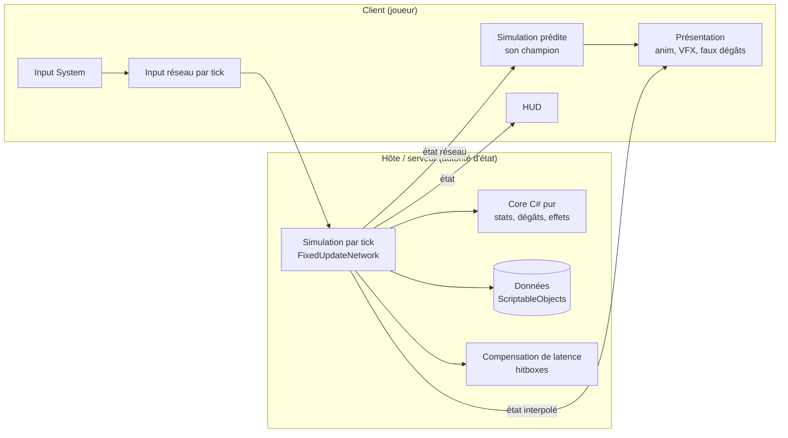
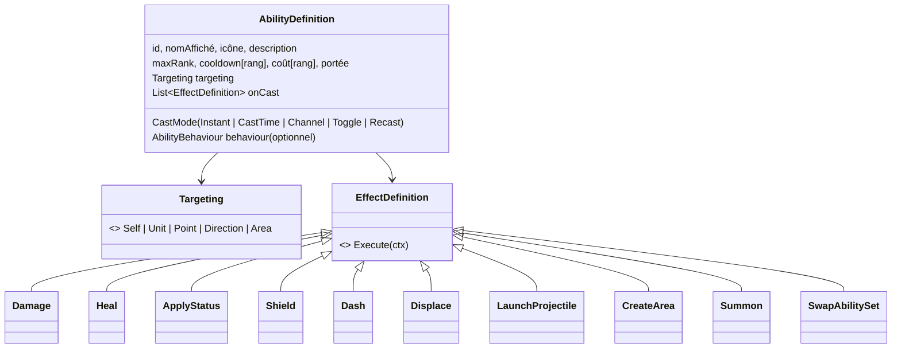
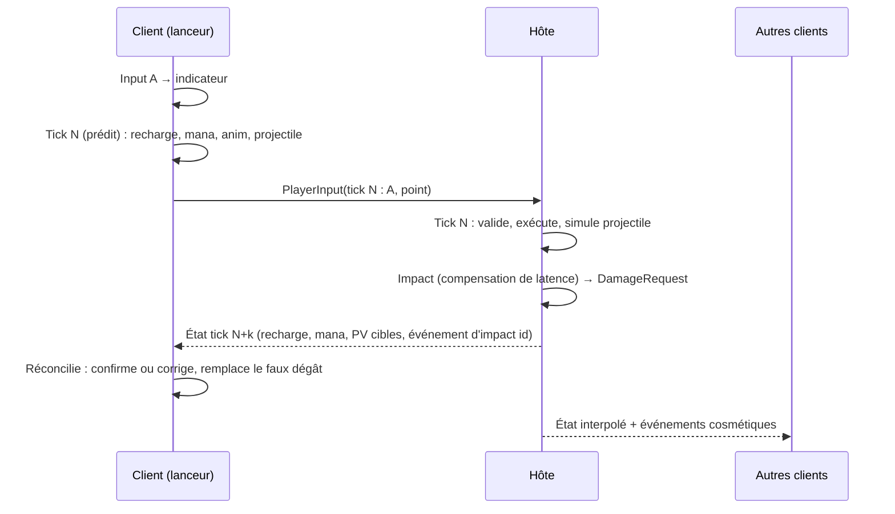
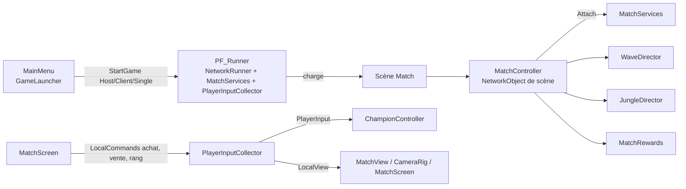

# MangaLegends — Architecture technique

> Statut : **v0.3** (2026-11-25). Décrit l'architecture visée ; l'implémentation actuelle et ses écarts sont au §15 ([ADR-0007](adr/0007-simplifications-premier-jalon-jouable.md)). L'ancien code est décrit dans [06-plan-refactor.md §1](06-plan-refactor.md#1-audit-du-code-existant).
> Toute modification structurelle met ce doc à jour et, si c'est une décision, ajoute un ADR dans [adr/](adr/).

## 1. Principes

1. **Serveur autoritaire, client prédictif.** Le serveur calcule et valide tout ce qui compte : dégâts, soins, recharges, mana, or, objets, morts. Le client **prédit** ses propres actions (déplacement, lancement, projectiles) et affiche des **retours provisoires** (« faux » dégâts, impacts) pour que le jeu paraisse instantané ; le serveur confirme ou corrige. ([ADR-0002](adr/0002-serveur-autoritaire.md))
2. **Simulation séparée de la présentation.** La simulation ne connaît ni l'UI, ni les animations, ni les VFX. Elle expose un état et des événements ; la présentation s'y abonne et peut prendre de l'avance (prédiction visuelle).
3. **Tout est configurable.** Champions, compétences, effets, objets, monstres, règles de partie et valeurs d'équilibrage sont des **données** (ScriptableObjects). Rien de gameplay n'est en dur. ([ADR-0003](adr/0003-competences-pilotees-par-les-donnees.md))
4. **Composition plutôt qu'héritage.** Une unité est un assemblage de composants (`Health`, `UnitStats`, `AbilityCaster`…).
5. **Dépendances explicites.** Pas de `GameObject.Find`, pas de singletons statiques mutables. Références sérialisées ou injectées par une composition root.
6. **Testable.** Les règles (stats, dégâts, recharges, effets) sont en C# pur dans `Core`, couvertes par des tests EditMode, indépendantes de la bibliothèque réseau.

## 2. Pile technique

| Sujet | Choix |
|---|---|
| Moteur | **Unity 6 LTS** ([ADR-0005](adr/0005-unity-6-lts.md)) |
| Réseau | **Photon Fusion 2**, mode **Host** (un ami héberge, relais Photon, pas de ports à ouvrir), mode **Server** dédié possible plus tard ([ADR-0006](adr/0006-photon-fusion-2.md)) |
| Entrées | Input System |
| Navigation | NavMesh (AI Navigation) pour le calcul de chemins ; déplacement simulé par notre code |
| UI | UGUI (UI Toolkit possible pour les menus) |
| Données | ScriptableObjects, Addressables quand le contenu grossit |
| Tests | Unity Test Framework (EditMode + PlayMode) |

Public visé : **jeu entre amis**, pas de diffusion publique. Le quota gratuit de Photon (100 joueurs simultanés) suffit.

## 3. Vue d'ensemble



### 3.1 Modèle de simulation (Fusion)

- La simulation avance par **ticks fixes** (`TickRate` 30 Hz au départ, configurable) dans `FixedUpdateNetwork()`.
- Le client n'envoie **pas de commandes libres** : il envoie chaque tick une **structure d'entrée** (`PlayerInput : INetworkInput`) : destination de clic, cible, boutons de compétence, point/direction visés, achat demandé.
- **Hôte** : exécute la simulation faisant foi (`HasStateAuthority`).
- **Client** : exécute la même simulation **pour son propre champion** en avance (prédiction), puis rejoue (resimulation) quand l'état serveur arrive. Les autres unités sont **interpolées** (`Render()`).
- Tout état qui doit être prédit ou répliqué est une propriété `[Networked]` ; aucune logique d'état ne dépend de `Update()` ni de coroutines.

### 3.2 Ce qui est prédit, ce qui ne l'est pas

| Élément | Client local | Serveur |
|---|---|---|
| Déplacement de son champion | prédit, corrigé | autorité |
| Début de lancement (anim, indicateur, recharge, mana) | prédit | valide (silence ? recharge ? mana ? portée ?) |
| Projectiles de son champion | prédits (simulés localement) | simulés + collisions avec **compensation de latence** |
| Impact, nombre de dégâts | **provisoire** : VFX + nombre « prédit » | calcule le vrai résultat ; le client remplace le provisoire, ou l'annule si l'impact n'a pas eu lieu |
| PV, boucliers, morts, or, objets, XP | jamais prédits (affichage provisoire seulement) | autorité |
| Autres unités (champions, sbires, monstres, tours) | interpolées | autorité |
| Aléatoire (critiques) | jamais tiré côté client | `NetworkRNG` / graine par tick |

## 4. Assemblies et dossiers

Le code vit dans `Assets/_Project/`. Chaque dossier = une assembly (`.asmdef`) : les dépendances interdites ne compilent pas.

| Assembly | Contenu | Dépend de |
|---|---|---|
| `MangaLegends.Core` | C# pur : `StatBlock`, `StatModifier`, `DamageCalculator`, `Cooldown`, logique des statuts, types | rien |
| `MangaLegends.Data` | ScriptableObjects : `ChampionDefinition`, `AbilityDefinition`, `EffectDefinition`, `ItemDefinition`, `UnitDefinition`, `GameRulesConfig`, `ContentRegistry` | Core |
| `MangaLegends.Simulation` | Composants réseau d'unités, compétences, projectiles, IA, économie, flux de partie (tout ce qui tourne dans `FixedUpdateNetwork`) | Core, Data, Fusion |
| `MangaLegends.Networking` | Démarrage du `NetworkRunner`, sessions, lobby, spawn des joueurs, collecte d'input | Simulation, Fusion |
| `MangaLegends.Input` | Actions Input System → `PlayerInput` | Simulation |
| `MangaLegends.Presentation` | Animation, VFX, audio, faux dégâts, indicateurs de visée, barres de vie | Simulation (lecture seule), Data |
| `MangaLegends.UI` | HUD, boutique, scores, menus | Simulation (lecture seule), Data |
| `MangaLegends.Editor` | Outils, validateurs de données | tout |
| `MangaLegends.Tests.EditMode` / `.PlayMode` | Tests | selon besoin |

Règle : **Core et Data ne référencent jamais Fusion, l'UI ni la présentation.** Si on change de bibliothèque réseau, seules `Simulation` et `Networking` bougent.

```
Assets/
  _Project/
    Core/ Data/ Simulation/ Networking/ Input/ Presentation/ UI/ Editor/
    Content/      (assets de données : Champions/, Abilities/, Items/, Units/, Rules/)
    Tests/EditMode/   (asmdef MangaLegends.Tests.EditMode)
    Art/ Audio/ Prefabs/ Scenes/ Settings/
  Photon/         (Fusion, géré par le SDK)
  Plugins/        (tiers)
Docs/
Tools/CoreTests/  (projets .NET pour compiler et tester le Core sans Unity)
```

## 5. Modèle d'unité

Toute entité combattante (champion, sbire, tour, monstre, invocation) est un prefab `NetworkObject` composé de :

| Composant | Responsabilité | État réseau |
|---|---|---|
| `Unit` | Identité : définition, équipe, type ; accès aux autres composants | `[Networked]` équipe, id de définition |
| `UnitStats` | `StatBlock` (Core), niveau, modificateurs actifs | niveau + liste compacte des modificateurs (source, type, valeur) |
| `Health` | PV, boucliers, mort, réapparition ; **seul point d'entrée des dégâts** | PV, boucliers |
| `ResourcePool` | Mana ou ressource alternative, régénération par tick | valeur |
| `StatusEffects` | Contrôles, buffs/debuffs, marques, cumuls, immunités | `NetworkArray` d'effets actifs (id, tick de fin, cumuls, source) |
| `UnitMotor` | Déplacement : chemin NavMesh calculé localement, avance de `vitesse × dt` par tick ; dashs, projections, téléports | position, destination, état de déplacement forcé |
| `AutoAttack` | Cible, portée, cadence, projectile d'AA | cible, tick de prochaine attaque |
| `AbilityCaster` | Emplacements P/A/Z/E/R, `AbilitySet` actif, rangs, recharges, charges, canalisation | tick de fin de recharge par emplacement, charges, set actif |
| `Vision` | Rayon de vision, révélation | — |
| `HitboxRoot` + `Hitbox` | Volumes pour la compensation de latence | géré par Fusion |
| Champion : `Experience`, `Wallet`, `Inventory`, `Scoreboard` | | `[Networked]` |
| IA : `MinionBrain`, `TowerBrain`, `MonsterBrain` | décisions, serveur uniquement | — |

Les temps (recharges, durées) sont stockés en **ticks** (`TickTimer`), jamais en `Time.time`.

## 6. Statistiques

- `StatType` : `MaxHealth, HealthRegen, MaxMana, ManaRegen, AttackDamage, AbilityPower, Armor, MagicResist, AttackSpeed, MoveSpeed, AttackRange, CritChance, CritDamage, Lethality, ArmorPen, MagicPen, LifeSteal, HealPower, AbilityHaste`.
- `StatModifier { StatType, ModifierKind (Flat | PercentAdd | PercentMult), float value, SourceId }` ; retrait **par source**.
- Valeur : `(base + croissance × (niveau − 1) + Σflat) × (1 + ΣpercentAdd) × Π(1 + percentMult)`, mise en cache.
- Unités : pourcentages en fraction (`CritChance 0.25`, `ArmorPenetration 0.3`, `PercentAdd 0.1` = +10 %), `CritDamage` en multiplicateur (`2` par défaut, 07 §11), `AttackSpeed` en attaques par seconde.
- **Distances en mètres** : 1 m = 100 unités du genre (portée 550 → 5,5 m, vitesse 325 → 3,25 m/s). Toutes les portées, rayons et vitesses des données suivent cette échelle.
- Implémentation : `MangaLegends.Core.Stats` (`StatBlock` implémente `IStatReader`, la base vient d'un `IStatBaseline` fourni par les données).
- Les formules (résistances, cadence d'attaque, plafonds) sont des paramètres de `GameRulesConfig`.

## 7. Combat

### 7.1 Pipeline de dégâts (autorité uniquement)

```
DamageRequest { source, target, amount, DamageType (Physical|Magical|True), flags (IsAbility, IsCrit…), abilityId }
  → modificateurs de l'attaquant (pénétration, bonus conditionnels)
  → résistance effective = résistance × (1 − péné. %) − péné. fixe (létalité), jamais < 0 si elle était positive
  → multiplicateur = S / (S + résistance), ou 2 − S / (S − résistance) si négative ; S = CombatRules.ResistanceScale (True : ignorée)
  → modificateurs du défenseur (réductions, absorptions)
  → boucliers (typés puis généraux)
  → Health.ApplyDamage → événements DamageApplied / Died (avec tick et id d'impact)
  → effets à l'impact (objets, passifs), vol de vie
```

### 7.2 Faux dégâts (retour provisoire côté client)

1. Le client prédit l'impact de son projectile / AA / compétence.
2. Il affiche immédiatement VFX, son et un **nombre provisoire** calculé avec `DamageCalculator` sur l'état qu'il connaît (style visuel distinct ou identique, au choix design).
3. Chaque impact porte un **id** (tick + emplacement + index). Quand l'événement serveur arrive avec le même id, le provisoire est remplacé par la vraie valeur ; s'il n'arrive pas dans un délai configurable, le provisoire est retiré.
4. La barre de vie peut montrer un segment « dégâts en attente » qui se confirme ou se restaure.

### 7.3 Effets de statut

`StatusEffectDefinition` : type (`Slow, Stun, Root, Silence, Knockup, Knockback, Taunt, Invisible, Untargetable, TimeStopped, Bleed, Burn, Mark…`), durée, valeur, cumul (`Refresh | Stack | Independent`), max de cumuls, tags. Requêtes : `CanMove`, `CanCast`, `CanAttack`, `IsTargetable`.
Marques (Gon, Kirito, Sasuke), cumuls (Zoro, Tanjiro) et boucliers (filtre de type, option « bloque les contrôles ») sont des statuts.

## 8. Compétences



- **Valeurs** : `ScalingValue { base[rang], ratios[] }`, chaque ratio = `{ source, stat, ratio[rang] }`. Valeur = base du rang + Σ ratio du rang × valeur de la source. Sources : stat totale, bonus ou de base du lanceur (AD, AP, PV, armure… : toute `StatType`), PV max / manquants / actuels de la cible, cumuls. Exemple : `60/100/140 (+50/60/70 % AP)`.
- **Tout champ chiffré d'une compétence peut varier par rang** : `RankedFloat` / `RankedInt` (Data), 1 valeur = constante sur tous les rangs, sinon `MaxRank` valeurs. Concerné : coût, coût par seconde, recharge, temps d'incantation et de canalisation, charges, portée et indicateurs, durée, cumuls et force des statuts (`ApplyStatusEffect.ModifierOverrides`), durée des boucliers, distance et vitesse des déplacements, nombre et dispersion des projectiles, vitesse, portée, rayon et cibles max des projectiles, taille, délai, durée et intervalle des zones, nombre et durée des invocations, durée d'un changement de forme. Les projectiles et zones prennent le rang de la compétence qui les crée : leur validation de rangs se fait depuis la compétence (`ValidateForOwner`).
- **Projectiles et zones** décrits en données (`ProjectileDefinition` : vitesse, portée, rayon, perce ou non, effets à l'impact ; `AreaDefinition` : forme, durée, intervalle, effets par intervalle).
- **Ciblage client** = indicateur et contenu de l'input ; l'autorité revalide.
- **Comportements spéciaux** (Pain, Rimuru, Jotaro) : petite classe `AbilityBehaviour` branchée sur la définition, qui réutilise les effets génériques et dont les paramètres restent en données.
- **Formes** : `AbilitySet` interchangeable (stand, pantins, Igris, monstre absorbé).
- **Projectiles réseau** : pas un `NetworkObject` par projectile. Chaque `AbilityCaster` tient un tampon circulaire `[Networked]` de projectiles (tick de départ, origine, direction, définition) ; la position se calcule à partir du tick. Prédit par le lanceur, vérifié par l'hôte avec compensation de latence.

### 8.1 Séquence d'un lancement



## 9. Réseau

- **Session** : `NetworkRunner` en `GameMode.Host` via le cloud Photon (code de salon partagé entre amis). Le code ne suppose jamais que l'hôte est un joueur : `GameMode.Server` doit rester possible.
- **Identifiants** : `NetworkId` / `PlayerRef`, jamais le nom d'un GameObject.
- **RPC** : réservés aux événements ponctuels non prédits (chat, ping, fin de partie). L'état passe par `[Networked]`.
- **Compensation de latence** : `HitboxRoot`/`Hitbox` sur les unités, requêtes `Runner.LagCompensation` pour les impacts.
- **Brouillard de guerre** : l'intérêt (Area of Interest de Fusion) limite ce qui est envoyé à chaque joueur selon la vision d'équipe.
- **Effets globaux** : arrêt du temps = statut `TimeStopped` sur toutes les unités sauf le lanceur ; vision totale = surcharge temporaire de l'intérêt pour une équipe.
- **Sécurité** : partie entre amis, l'hôte fait foi ; on ne vise pas l'anti-triche contre un hôte malveillant.

## 10. Flux de partie

Scènes : `Boot` → `MainMenu` (créer / rejoindre un salon) → `Lobby` → `ChampionSelect` → `Match` (+ carte additive) → `PostGame`.
`MatchController` (autorité) : `WaitingForPlayers → Loading → Playing → Ended`, horloge en ticks, vagues, réapparitions, victoire. Règles dans `GameRulesConfig`.

Structures (GDD §6.1) : chaque tour, inhibiteur et Cœur placé sur la carte référence la structure qui le protège ; tant qu'elle tient, l'autorité refuse les dégâts. L'inhibiteur détruit lance un `TickTimer` de réapparition (`InhibitorRespawnSeconds`) et, pendant ce temps, le générateur de vagues de la voie remplace `SiegeMinion` par `MegaMinion`. Les tours reçoivent `EarlyTowerModifiers` jusqu'à `EarlyTowerDefenseSeconds`. Vagues : première à `FirstWaveSeconds`, intervalle et fréquence du siège en paliers de temps (`TimedValue[]`, valeurs de [07 §5](07-regles-de-jeu.md#5-sbires)). Ces règles sont vérifiées par `GameRulesConfig.Validate` (appelée par `ContentRegistry.Validate`).

## 11. Données et contenu

- Chaque définition a un **`id` stable** (`champion.ainz`, `ability.ainz.mantle_of_chaos`) ; le réseau transporte un **index compact** fourni par `ContentRegistry`.
- `ContentRegistry` liste toutes les définitions et construit un `ContentIndex<T>` par type (tri par id ordinal → même index réseau sur tous les pairs) ; *MangaLegends → Content → Validate* vérifie ids, doublons, tableaux par rang, références et recettes circulaires.
- Effets : classes `[Serializable]` dérivées de `EffectDefinition`, stockées en `[SerializeReference]` dans les compétences, projectiles, zones, statuts et objets ; l'inspecteur propose le type via `TypeSelectorAttribute`. Les effets sont des **données** : leur exécution vivra dans `Simulation` (étape 7), par un exécuteur par type d'effet.
- Valeurs par rang : tableau de 1 valeur (constante) ou de `MaxRank` valeurs.
- Coût : `Cost` au lancement et `CostPerSecond` tant qu'une compétence `Toggle` ou `Channel` est active (prélevé par tick par l'autorité ; ressource à 0 → la compétence s'arrête 🟡).
- Sorts d'invocateur : `SummonerSpellDefinition` (index `ContentRegistry.SummonerSpells`) enveloppe une `AbilityDefinition` ; le nombre d'emplacements vient de `GameRulesConfig.SummonerSpellSlots`. Ils passent par le même pipeline de lancement que les compétences. `TargetingData.Fallback` gère la cible de repli (allié le plus bas en PV) et `TeleportEffect` la téléportation vers une unité alliée.
- Économie : `ItemPricing` (Core) calcule coût total, devis d'achat (composants possédés consommés, y compris imbriqués) et revente ; l'autorité l'utilise, le client seulement pour l'affichage.
- Noms et textes affichés dans les données (localisables plus tard).
- Équilibrage : modifier un asset suffit ; pas de recompilation.

## 12. UI et entrées

- HUD lié au champion local via un `LocalPlayerContext` fourni au démarrage ; vues sans règles, abonnées aux événements.
- Input System, un asset `MangaControls.inputactions` (carte `Gameplay`), remappage sauvegardé dans les `PlayerPrefs` par `ControlSettings` (avec le mode de lancement de chaque touche). `PlayerInputCollector` remplit `PlayerInput` dans le callback `OnInput` de Fusion. Aucun autre script ne lit les entrées ; la page Options ne fait que lancer `PerformInteractiveRebinding`.
- **Lancement comme dans LoL** (réglable par touche) : *normal* (la touche affiche l'indicateur, clic gauche lance, clic droit ou Échap annule ; une compétence à cible unitaire attend un clic sur une cible valide), *rapide avec indicateur* (maintenir pour viser, relâcher pour lancer), *rapide* (lance au curseur à l'appui). Les compétences sans visée (soi, aucune) partent toujours à l'appui ; Alt + touche lance sur soi une compétence qui accepte un allié. L'attaque-déplacement suit le même réglage (cercle de portée d'attaque, puis clic). Valeurs par défaut : normal partout, comme le client LoL.
- Le collecteur expose l'état de visée dans `LocalView` (`IsAiming`, `AimButton`) ; `AimIndicator` (présentation) le dessine : cercle de portée, puis la forme lue dans les effets du sort (`AimShape` : ligne de projectile et éventail, cône ou rectangle de zone, cercle au curseur borné à la portée, trajectoire de ruée), rouge si le sort n'est pas prêt. `TargetingData.IndicatorWidth/Radius` remplacent la forme déduite si renseignés. `AimSource` (Simulation) donne, pour une touche, le ciblage, les effets, le rang et la disponibilité, compétence ou actif d'objet.

## 13. Tests et outils

- EditMode : Core (stats, dégâts, cumuls, recharges), validation des données.
- PlayMode : partie locale en hôte, lancement de compétence, achat.
- Multi-instances : Multiplayer Play Mode d'Unity 6 pour tester plusieurs clients dans l'éditeur.
- Simulation de latence (réglages Fusion) pour valider la prédiction.
- Triches en build de développement uniquement, passées par l'input et exécutées par l'autorité.

## 14. Points à prototyper en premier

1. **Déplacement prédit sur NavMesh** (clic-pour-bouger + resimulation) : vérifier coût et stabilité.
2. **Projectile prédit + compensation de latence + faux dégâts** de bout en bout.
3. Volume d'état réseau pour 10 champions + ~60 sbires à 30 Hz.

## 15. Implémentation actuelle (2026-11-25)

Écarts avec la cible : [ADR-0007](adr/0007-simplifications-premier-jalon-jouable.md) (impacts sans compensation de latence, salon dans la scène `Match`, interface construite en code).

### 15.1 Assemblies et fichiers

| Assembly | Contenu principal |
|---|---|
| `Simulation` | `Units/` (`Unit`, `UnitStats`, `Team`), `Combat/` (`Health`, `ResourcePool`, `StatusEffects`, `AutoAttack`), `Movement/UnitMotor`, `Abilities/` (`AbilityCaster`, `ProjectileLauncher`, `AreaSpawner`, `EffectExecutor`, `EffectContext`, `AbilityBehaviours`, `AimSource`), `Combat/CombatTriggers`, `Champions/` (`ChampionController`, `ChampionProgress`, `Inventory`), `Match/` (`MatchController`, `MatchRewards`, `WaveDirector`, `JungleDirector`, `PlayerSlot`, `MapLayout`), `AI/` (`MinionBrain`, `TowerBrain`, `MonsterBrain`, `TargetSelection`), `Services/` (`MatchServices`, `UnitRegistry`, `LocalCommands`, `LocalView`), `Input/PlayerInput` |
| `Input` | `PlayerInputCollector`, `ControlSettings` (touches et modes de lancement), `MangaControls.inputactions` |
| `Networking` | `GameLauncher` (hôte, rejoindre par code, solo, quitter) |
| `Presentation` | `MatchView`, `CameraRig`, `UnitView`, `AbilityVisuals`, `AimIndicator`, `AimShape`, `MinimapCapture` |
| `UI` | `UiFactory`, `MainMenuScreen`, `MatchScreen` (+ `LobbyPanel`, `HudPanel`, `ShopPanel`, `ScoreboardPanel`, `WorldOverlay`, `SettingsPanel`, `TeamBarPanel`, `MinimapPanel`, `AnnouncementPanel`) |

Contenu : `Assets/_Project/Content/` (données), `Prefabs/` (`PF_Runner`, `PF_PlayerSlot`, `Units/PF_*`), `Scenes/` (`MainMenu`, `Match`), `Art/` (matériaux, NavMesh).

### 15.2 Services et flux



- `MatchServices` vit sur le runner (`MatchServices.Of(runner)`) : contenu, règles, registre des unités, carte, partie, commandes et vue locales.
- Phases de `MatchController` : `Lobby` (un `PlayerSlot` par joueur, choix par RPC, l'hôte lance) → `Playing` → `Ended` (destruction d'un Cœur).
- Les tours, inhibiteurs et Cœurs sont créés au lancement depuis `MapLayout` ; leur protection (`Unit.Protectors`, `ProtectionMode`) rend l'autorité invulnérable tant que la structure précédente tient.

### 15.3 Tick d'une unité

`Unit.FixedUpdateNetwork` : `Stats.Refresh` → `Status.Simulate` (expirations, effets périodiques) → `Health.Simulate` (boucliers, régénération) → `Resource.Simulate` → cerveau (`ChampionController` lit l'input, IA côté hôte) → `Caster.Simulate` (canalisation, cible à rejoindre, passif, projectiles, zones) → `Attack.Simulate` → `Motor.Simulate`.

- Seul le champion local est simulé chez le client (prédiction Fusion) ; les autres unités sont des proxys interpolés par `NetworkTransform`.
- Effets exécutés partout (prédits) : `Dash`, `LaunchProjectile`, `CreateArea`, `SwapAbilitySet`. Effets réservés à l'autorité : dégâts, soins, boucliers, statuts, purification, déplacements forcés, téléportation, échange, invocation.
- Chemins NavMesh stockés dans l'état réseau (16 coins) pour une resimulation identique.
- Collision douce côté hôte pour les sbires et les monstres (jamais prédits) : chacun s'écarte des unités qui le chevauchent (moitié de l'écart entre deux sbires, tout l'écart face à un champion ou une structure), sans traverser les murs du NavMesh. Les champions n'en ont pas, pour garder la prédiction exacte.
- **Brouillard de guerre** (ADR-0007 §9) : `TeamVision` (dans `LocalView`, mis à jour par `MatchView`) dit si une unité ou un point est vu par l'équipe du joueur local ; `UnitView`, `WorldOverlay`, `AbilityVisuals` et le survol du `PlayerInputCollector` s'en servent. Rayons : champions 12 m, sbires 11 m, tours et structures 13,5 m (LoL : 1 350 / 1 100 / 1 350 unités, arrondis) ; Wado Ichimonji +2 m. Les buissons de `MapLayout` coupent la vue : un œil ne voit une unité en buisson que s'il est dans le même buisson. Les murs (calque `Terrain`, 9) bloquent la ligne de vue (`Physics.Linecast` à hauteur des yeux).
- **Objectifs épiques** : un statut peut survivre à la mort (`PersistsThroughDeath` : cumuls de drake, âmes, Faim des Chimères), avoir une recharge commune à ses déclencheurs (`TriggerCooldownSeconds`, état réseau `NetStatus.TriggerReadyTick`), filtrer ses déclencheurs par type de l'autre unité (`TriggeredEffect.OtherKinds`) et lancer des effets quand il atteint son maximum (`OnMaxStacks`). `MonsterDefinition` : `IsDrake`, `SoulReward`, `ScalesWithAverageLevel`. `MatchController.DrakeKills` compte les drakes par équipe ; au seuil (`GameRulesConfig.DrakesForSoul`), `MatchRewards` donne l'âme. `CampPlacement` : `Rotation` (une créature par apparition, tirée par `ElementRotation` : sans répétition puis élément fixe à partir de `GameRulesConfig.DrakeElementLocksAfter`), `AfterSoul` (Shenron dès qu'une équipe a l'âme), `DespawnSeconds` (larves, Ogrest). `JungleDirector` applique le niveau moyen des champions aux monstres concernés. Nouveaux effets : `ExecuteEffect`. Les zones peuvent ne viser que certains types d'unités (`AreaDefinition.Kinds`, aura de Zodd sur les sbires). Stat `RecallTimeReduction` (rappel de Zodd).
- **Balises** : `UnitKind.Ward`, unités sans cerveau de combat (`WardBrain` : poseur, date de pose, fin de vie). `UnitDefinition` : `Stealthed` (invisible pour l'ennemi sauf à portée d'un révélateur), `RevealsStealth` (révèle et désactive les balises ennemies : elles ne donnent plus de vision), `OneDamagePerHit` (1 PV par attaque de base, compétences ignorées). `PlaceWardEffect` → `MatchController.PlaceWard` (au plus N par poseur, la plus ancienne disparaît). Le bijou est un 9e emplacement du lanceur (`CasterSlot.Trinket`, touche 4) dont le rang suit le niveau du champion ; un objet peut être consommé à l'usage (`ItemActive.ConsumedOnUse`). L'IA (`TargetSelection`) et l'attaque-déplacement ignorent les balises. Bijou au choix parmi `GameRulesConfig.TrinketChoices` (choix envoyé par l'input, validé à la fontaine) ; un monstre peut remplacer temporairement le bijou du tueur (`MonsterDefinition.KillerTrinket`, Œil d'Ogrest), rétabli après usage (`BehaviourId` `restore_trinket`) ou à la fin du délai. `ChargerBrain` : invocation qui fonce sur la tourelle ennemie la plus proche et lui inflige son AD en dégâts bruts. Un statut peut révéler les unités cachées (`StatusEffectDefinition.RevealRadius`, Haki de l'observation).
- **Performances** (2026-11-25, ~1 900 → ~10 ms par image) : `UnitMotor.MoveTo` ne recalcule pas un chemin d'unité IA vers la même destination avant 0,25 s ; plus d'échantillonnage NavMesh à chaque pas ; séparation des sbires une fois sur deux via une grille spatiale (`UnitRegistry.Nearby`, reconstruite une fois par tick) ; `Closest` et `Query` testent la distance avant les filtres coûteux. Marqueurs du profileur `ML.Unit.*` dans le tick des unités.
- **Sbires sur leur voie** : les voies portent la zone NavMesh `Lane` (3, `NavMeshModifierVolume`) ; `UnitMotor` calcule le chemin des sbires avec un filtre où le reste de la carte coûte 4 fois plus, donc ils ne passent par la jungle que si la voie est bloquée ; les champions gardent le plus court chemin. Les voies sont symétriques, les vagues se rencontrent au milieu.
- **Retour à la base** : statuts `GameRulesConfig.HomeguardEarly/Late` donnés par `MatchController` (réapparition, rappel), retirés par `UpdateHomeguard` en combat ou hors voie/base (`MapLayout.IsOnLaneOrBase`). `FireFountains` : la fontaine tue les champions ennemis.
- **Barres de vie** (`WorldOverlay.BarView`) : plus grandes ; champions avec niveau, nom et mana ; bouclier en blanc ; masquées pour les structures encore protégées et les balises ; toujours à plat face à l'écran (UI en surimpression). Touches des objets affichées en chiffres (1, 2, 3, 5, 6, 7) même en AZERTY.
- **Modèles des structures** (2026-11-25) : inhibiteurs et nexus = modèles LoL `.glb` de `Assets/Sprites/Map` (glTFast), à leur origine d'origine (plateau au sol, partie basse enterrée) ; `UnitView` joue leurs clips d'animation hérités selon l'état (`_aliveClip`, `_deathClip`, `_deadClip`, `_respawnClip`) et montre le modèle bleu ou rouge selon l'équipe. Les fichiers `turrets_blue/red.glb` ne contiennent que la tourelle détruite (matériau « Rubble ») : tourelle debout provisoire en primitives, gravats LoL (`turrets_(destroyed).glb`) à la destruction.
- **IA des sbires (LoL)** : `TargetSelection.PickForMinion` ; priorités : champion ennemi qui frappe un champion allié, sbire ennemi qui attaque un champion allié, sbire ennemi qui attaque un sbire allié, tourelle qui attaque un sbire allié, sbire le plus proche, champion le plus proche (seulement s'il n'y a rien d'autre), structures. Changement de cible seulement pour une priorité plus haute ou si la cible sort de portée. Frapper un sbire n'attire plus les sbires sur un champion (patch 26.10). Sbires lancés un par un en file (`GameRulesConfig.MinionSpawnIntervalSeconds`, 0,8 s). Collision très légère : les sbires traversent les champions et ne se poussent que faiblement entre eux.
- **Modèles des personnages** (2026-11-25) : Mark Evans (`Mark Evans/Mark Evans.fbx`, ballon `skin4` masqué ; `Mark.fbx` à la racine ne contient aucun maillage), Giorno et Jotaro (Collada couchés, redressés, avec leurs stands), Pain (`NTBSS_Pain.dae`, debout) ; prefabs copiés de celui de Kirito, modèle mis à l'échelle (2 m, Mark 1,8 m), os reliés à `ProceduralRig`. Luffy (`luffy.glb`, forme Gear 5 `luffy_gear_5.glb` pendant son R), Kirito (Collada couché, redressé), Sulfura, Artikodin, Électhor, Lugia (FBX Pokémon). Sans clips d'animation utilisables : `ProceduralRig` anime les os (marche selon la vitesse réelle, bras baissés depuis la pose en T ; Luffy : bras droit qui s'allonge sur les attaques quand le passif est armé et sur A, Gatling bras gauche puis droit tant que le statut dure, Rocket : la main reste sur la cible pendant que le corps file ; oiseaux : vol stationnaire, battements d'ailes, queue, coup de bec). Structures solides (`NavMeshObstacle` qui découpe le NavMesh).
- **Mort** (2026-11-25) : écran gris (`DeathGrayscale`, effet de caméra), caméra libre (plus verrouillée tant qu'on est mort), récapitulatif des dégâts des 15 dernières secondes par source et par type (`DeathRecapPanel`).
- **HUD** : icônes des effets au-dessus de la barre (balayage circulaire du temps restant, carré plein si sans durée), recharge du passif affichée comme celle des sorts. Barres de vie : boucliers par couleur (blanc tous dégâts, orange physiques, violet magiques).
- **Ciblage des sorts sur une unité** (07 §11) : l'unité sous la souris, en lancement rapide comme normal ; l'ancien réglage `SnapToNearestTarget` est supprimé. **Attaque-déplacement** (Q-clic) : `ChampionController` attaque l'ennemi à `GameRulesConfig.AttackMoveRadius` du clic, sinon l'ennemi à portée le plus proche du clic, sinon marche vers le clic (`AttackMoving`, état réseau) et attaque le premier ennemi qui arrive à portée. **Passif armé** : `AbilityDefinition.ReadyStatus` reste sur le champion tant que le passif est prêt (cumuls = base + niveau ; portée de Luffy). **Forme** : `UnitView` remplace le modèle tant qu'un statut donné est actif, avec une bouffée de fumée (Gear 5).
- **Mécaniques ajoutées pour Mark Evans, Giorno, Jotaro et Pain** (2026-11-25), toutes en données :
  - `StatusEffectDefinition` : `Invulnerable` (aucun dégât, dans `Health.ApplyDamage`), `AbilityDamageReduction` (part des dégâts hors attaques de base ignorée ; avec `ReductionArcDegrees`, seulement si la source est dans l'arc autour de la direction du lancement, gardée dans `NetStatus.DirX/DirZ` : mur de Mark), `RedirectToSource` (lien : la source du statut encaisse cette part des dégâts ; les procs ne sont pas partagés, donc pas de chaîne), `Taunt` (`Unit` ignore son cerveau et attaque la source), `BlocksNextBasicAttack` (la prochaine attaque de base reçue est annulée et retire le statut), `RemovedOnTrigger` (statut consommé dès qu'un de ses déclencheurs a joué : prochaine attaque renforcée), `OnOutOfCombat` (effets joués puis statut retiré quand l'unité sort du combat : choix de Pain après un kill). Les déclencheurs d'un statut prennent son `RankCount`.
  - **Sorts activables** (`CastMode.Toggle`, `AbilityDefinition.ToggleStatus`) : lancer pose le statut (sans durée), relancer le retire ; `AbilityCaster.PayToggles` prélève `CostPerSecond` à chaque tick et coupe le sort quand le mana manque. Un sort activable qui quitte la barre (changement de jeu de compétences) est coupé, sauf si le nouveau sort partage le même statut (Z de Giorno avec ou sans stand).
  - **Jeux de compétences** : `SwapAbilitySetEffect.Step` (+1 ou −1) fait tourner le cycle « défaut puis alternatifs » (`AbilityCaster.StepSet`, pantins de Pain). `ApplyStatusEffect` peut exiger sur la cible un statut dont le nombre de cumuls est entre deux bornes (fleurs de Giorno : la 2e immobilise, la 3e étourdit).
  - **Passifs** (`BehaviourId`) : `periodic` (effets toutes les N s : jauge de Pain), `while_in_brush` (le `ReadyStatus` reste tant que le champion est dans un buisson : régénération de Giorno).
  - **Compétences** : `AbilityDefinition.RequiredStatus` (lançable seulement avec ce statut, sinon `IsReady` est faux) et `StartsLearned` (rang 1 dès le début, hors points de compétence : R de Pain).
  - **Objets réservés** : `ItemDefinition.IsChampionExclusive` (ni boutique, ni achat, ni vente) et `ChampionDefinition.StartingItems`, donnés par `MatchController` via `Inventory.Grant` (Gants de David Evans). `ApplyStatusEffect.OnePerCaster` retire le statut des autres unités qui le tenaient du même lanceur (un seul allié lié).
  - **Effets** : `DrainResourceEffect` (part du mana actuel prise à la cible), `PayHealthEffect` (le lanceur paie des PV, jamais mortel), `ResetAttackEffect` (réinitialise l'attaque de base), `HealEffect.AnyTeam` (rendre des PV volés), `DisplaceEffect.FromImpactPoint` (attirer vers le centre d'une zone) et `DisplacementKind.Random` (direction tirée de façon déterministe), `RemoveStatusEffect`.
  - **Stands** : `UnitView` montre un modèle compagnon (`_companionModel`) derrière le champion tant qu'un statut est actif (Gold Experience, Star Platinum), avec son propre `ProceduralRig`.
  - **Arrêt du temps** : zone de 400 m qui pose `status.time_stop` (ni déplacement, ni attaque, ni sort, ni objet) sur toutes les unités sauf le lanceur. Ce n'est pas un contrôle : il n'est ni bloqué ni purifié.
- **Flottement** : `UnitView._floats` (Ainz) : pas d'animation de course (`Speed` à 0), le modèle reste à `_floatHeight` du sol, ondule et se penche dans le sens du déplacement.
- **Modèles animés** : `UnitView` pilote un `Animator` s'il en a un (`Speed` d'après le déplacement réel, `Attack` à chaque attaque de base, `AttackSpeed` pour caler un clip par attaque) ; sinon il garde l'animation de remplacement (écrasement à l'attaque). `_tintBody` désactivé pour les modèles texturés. Contrôleur commun aux champions humanoïdes : `Art/Animations/ANIM_Champion_Humanoid.controller`.
- **Zones de carte** : `MapLayout` décrit la rivière (rectangle en diagonale et fosses circulaires) et les buissons (`MapZone`, rectangle orienté ou cercle). `Health` retire chaque tick, côté autorité, une part des PV max aux champions `DevilFruitUser` qui se tiennent dans la rivière (`GameRulesConfig` : 1,5 %/s, non mortel par défaut), sans les mettre en combat.
- **HUD à la LoL** (`HudPanel`, `TeamBarPanel`, `MinimapPanel`) : au centre, stats (AD, AP, armure, RM, VA, accélération, critique, vitesse), portrait avec niveau et barre d'XP, passif, 4 compétences avec rangs, 2 sorts d'invocateur, barres de PV et de mana avec régénération, rangée de buffs et debuffs ; à droite, inventaire avec touches, recharge des actifs, rappel et or. En haut à droite, frags des deux équipes, K/D/A, CS et chrono ; à gauche, cadres des alliés (PV, niveau, réapparition). Annonces au centre (`AnnouncementPanel` : premier sang, « vous avez été tué », double à pentakill dans une fenêtre de 10 s, tourelle et inhibiteur détruits, monstre épique vaincu) et fil des frags sous le score, déduits sur chaque client des morts répliquées. Minicarte en bas à droite : image de la carte rendue une fois d'en haut par `MinimapCapture` (calque des unités exclu), points des unités visibles, cadre de la caméra ; clic gauche = caméra (`LocalView.CameraFocusRequest`), clic droit = déplacement (`LocalCommands.RequestMove`, repris par le collecteur).
- **Effets génériques ajoutés pour Luffy et Kirito** : `DamageEffect` peut lire les cumuls d'un statut (`StacksFrom`, sur la cible ou le lanceur) pour la source de mise à l'échelle `Stacks`, exiger un minimum (`MinStacks`) et les consommer ; `ReduceCooldownEffect` divise la recharge restante d'une compétence du lanceur ; un statut déclare `RankCount`, le nombre de rangs de ses effets périodiques (il prend le rang de la compétence qui l'applique). Un statut appliqué rafraîchit tout de suite les stats de la cible (une réduction d'armure compte pour les dégâts du même effet).
- **Déclencheurs de combat** (`CombatTriggers`, autorité seule) : l'attaque de base (`OnHit`), les dégâts de compétence (`OnAbilityHit`, plus `OnHit` si `AppliesOnHitEffects`), les soins (`OnHeal`), la mort (`OnKill` pour le tueur), les dégâts subis (`OnDamageTaken`) et chaque tick (`Periodic`, objets avec recharge seulement) réveillent les passifs d'objets (`Inventory`, recharge par emplacement en état réseau), les `Triggers` des statuts actifs (bonus de Totoro) et le passif du champion dont le `BehaviourId` est `on_hit`, `on_hit_champion`, `on_ability_hit`, `on_kill` ou `on_damage_taken`. Les effets ainsi lancés sont des *procs* (`DamageFlags.Proc`, `EffectContext.IsProc`) : ils ne redéclenchent rien chez le même propriétaire, ce qui borne les chaînes. Les dégâts périodiques des statuts sont aussi des procs.
- Retours visuels : l'historique réseau des coups (`Health.Hits`) alimente les dégâts flottants ; les tampons de projectiles, zones et attaques sont dessinés par `AbilityVisuals`.
